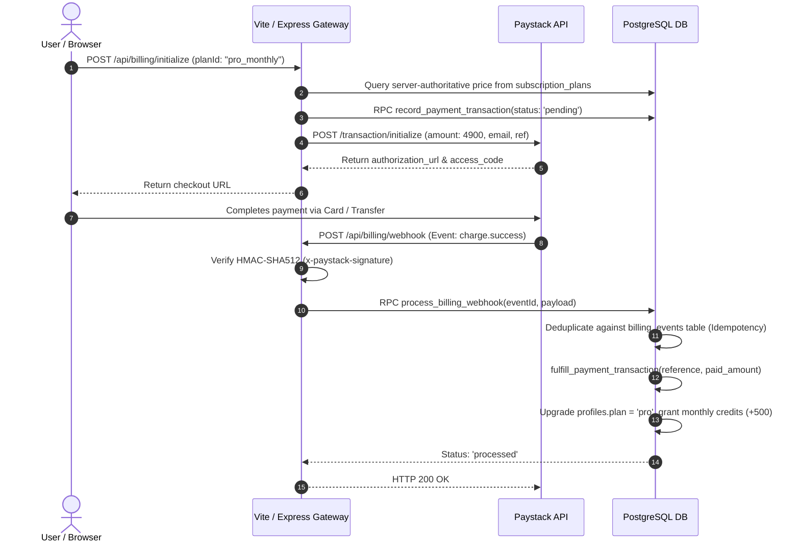
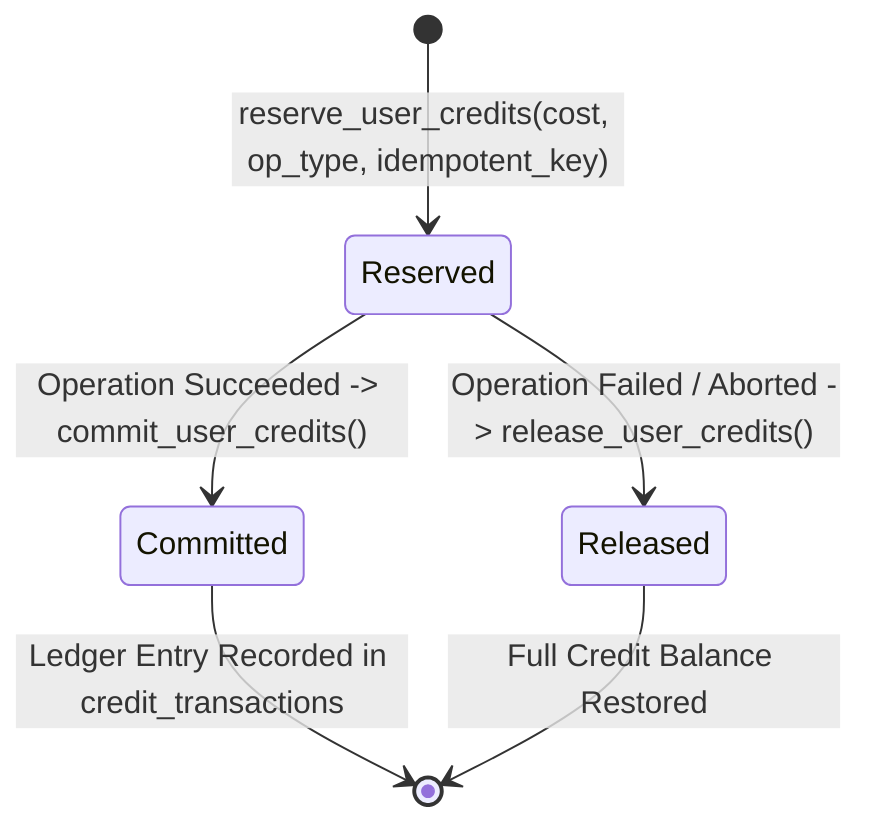

# ChainForge AI — Commercialization Architecture Specification

## 1. Executive Summary

ChainForge AI is an enterprise-grade, multi-tenant Web3 builder and growth orchestration platform. It operates on a **hybrid commercial monetization model** combining recurring subscriptions with metered, usage-based compute credits. This architecture guarantees financial isolation, cryptographic security, replay-resistant payment webhooks, and deterministic AI resource allocation.

---

## 2. Multi-Tenant Architecture & Security Model

```mermaid
graph TD
    User["End User / Tenant Browser"] -->|HTTPS + Bearer JWT| ViteProxy["Vite Gateway / Middleware Layer"]
    ViteProxy -->|HMAC-SHA512 Verification| PaystackWebhook["/api/billing/webhook"]
    ViteProxy -->|Two-Phase Metering Engine| AIMiddleware["/api/generate-blueprint & /api/generate-codebase"]
    ViteProxy -->|Tenant Scoped REST| GrowthEngine["/api/growth/* (Community, Campaigns, KOLs)"]
    
    subgraph "Supabase PostgreSQL Infrastructure"
        DB_RLS["PostgreSQL Row-Level Security (RLS)"]
        AIMiddleware -->|reserve / commit / release| DB_RPC["Security Definer RPCs"]
        PaystackWebhook -->|idempotent fulfillment| DB_RPC
        GrowthEngine -->|auth.uid() scoped queries| DB_RLS
        DB_RPC --> DB_Tables[("Profiles, Subscriptions, Ledger, Growth Modules")]
    end
```

### 2.1 Multi-Tenant Isolation Guarantees
1. **Private by Default**: All generation endpoints (`/api/generate-blueprint`, `/api/generate-codebase`), project creation, compiler workflows, and growth modules require valid Supabase Auth Bearer tokens.
2. **PostgreSQL Row Level Security (RLS)**:
   - Tables (`projects`, `subscriptions`, `payment_transactions`, `community_channels`, `campaigns`, `content_drafts`, `kols`, `growth_analytics`) enforce `user_id = auth.uid()`.
   - Anonymous mutations are denied via zero-trust database constraints.
   - All server-side updates bypass RLS only through audited, transactional `SECURITY DEFINER` procedures with explicit `SET search_path = public`.
3. **Multi-Tenant Team RBAC**:
   - `organizations` table groups projects, shared credit pools, and audit logs.
   - `organization_members` enforces roles (`owner`, `admin`, `builder`, `viewer`) with cascading membership checks.

---

## 3. Payment Processing Architecture (Paystack Gateway)

### 3.1 Financial Integer Minor Units Rule
- No floating-point arithmetic is permitted in billing calculations.
- All monetary transactions are computed and stored in **minor units** (USD cents or NGN kobo) using standard integer arithmetic.
- Example: `$49.00 USD` is represented as `4900`.

### 3.2 Server-Authoritative Pricing
- The frontend client never dictates subscription prices or credit amounts.
- All pricing is derived directly from the immutable `subscription_plans` database table or `CREDIT_PACKAGES` server configuration.

### 3.3 End-to-End Checkout Sequence



### 3.4 Webhook Cryptographic Verification & Idempotency
- **HMAC-SHA512 Signature**: Computed over raw request body using `crypto.createHmac('sha512', secretKey)`.
- **Timing Attack Defense**: Verified using `crypto.timingSafeEqual()` preventing timing side-channel exploits.
- **Idempotency Defense**: Paystack events are recorded in `public.billing_events(event_id)`. Replayed webhooks encounter unique constraint violations and immediately return `{ status: 'ignored_duplicate' }` with HTTP 200 without double-crediting.

---

## 4. Two-Phase AI Usage Metering & Credit Engine

Long-running generative AI operations (such as multi-stage blueprint structuring and full Web3 codebase compilation) are susceptible to network drops, upstream rate limits, or context window exceptions. 

To eliminate customer billing disputes and prevent quota exhaustion attacks, ChainForge implements a **Two-Phase Commit Metering Pattern**:



1. **Phase 1 (Reserve)**:
   - Atomically locks the user profile (`SELECT ... FOR UPDATE`).
   - Verifies active account status and sufficient credit balance.
   - Deducts requested credits into `reserved` state in `public.usage_events`.
   - Immediately reflects reduced available balance to prevent concurrent overspending.
2. **Phase 2A (Commit)**:
   - On successful AI stream completion or codebase synthesis, transitions status from `reserved` to `committed`.
   - Inserts immutable ledger entry into `public.credit_transactions`.
3. **Phase 2B (Release / Rollback)**:
   - If AI provider throws an error, rate limits, or client disconnects, `release_user_credits` is triggered.
   - Atomically increments user's `credits_balance` back to the exact initial amount.
   - Marks reservation event as `released` with failure reason.

---

## 5. Growth Modules Persistence Engine

The platform integrates five high-velocity Web3 go-to-market modules:
1. **Community Intelligence (`public.community_channels`)**: Tracks Discord, Telegram, and X community growth rates, member metrics, and sentiment scores.
2. **Campaign Hub (`public.campaigns`)**: Manages multi-channel acquisition campaigns with budget tracking and conversion analytics.
3. **Content Studio (`public.content_drafts`)**: Stores AI-generated marketing copy, announcements, technical threads, and schedule metadata.
4. **KOL Discovery Engine (`public.kols`)**: CRM for Web3 Key Opinion Leaders, influencer tiering, audience metrics, and outreach pipelines.
5. **Growth Analytics (`public.growth_analytics`)**: Aggregates TVL, daily active wallets, community engagement, and token holder velocity.

All growth modules feature complete multi-tenant tenant isolation with project-level foreign keys and user authorization boundaries.
