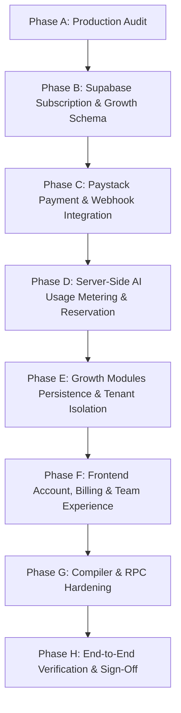

# ChainForge AI — Production Readiness & Architecture Audit

**Audit Date:** October 23, 2026  
**Auditor:** Principal Software & Security Architect  
**Repository:** ChainForge AI (`github.com/chainforge-ai`)  
**Deployment Infrastructure:** Supabase PostgreSQL (`zrxgkyhzqdyyqtsmwixy`), Vite 8 / React 19 Frontend, Node.js API Middleware  

---

## 1. Executive Summary & Baseline State

This audit establishes the baseline architectural state, production readiness, and security posture of the ChainForge AI codebase following the initial security remediation and commercialization passes.

### Baseline Test Execution Results (Executed October 23, 2026)
- **TypeScript Static Analysis (`tsc --noEmit`)**: **0 Errors (PASS)**
- **Vite Production Bundle (`vite build`)**: **Built in 3.47s (PASS)**
- **Security & RLS Regression Suite (`scripts/verify-security.mjs`)**: **42 / 42 Tests Passed (100%)**
- **Controlled-Access & Credit Suite (`scripts/verify-commercialization.mjs`)**: **20 / 20 Tests Passed (100%)**
- **Total Baseline Verified Assertions**: **62 / 62 Tests Passed**

---

## 2. Implemented vs. Incomplete Capabilities

| Feature Domain | Existing State | Production Readiness Gaps |
| :--- | :--- | :--- |
| **Authentication & Identity** | Supabase Auth integrated (`AuthService`, `AuthModal`, `AuthContext`). Session persistence active. | Needs multi-seat organization/team membership support and invite workflows for team tiers. |
| **Controlled Access** | Private-by-default gate on generation endpoints (`/api/generate-blueprint`, `/api/generate-codebase`, `/api/projects`). | Direct UI upgrade triggers and billing portal redirect need integration. |
| **Credit Accounting** | Atomic SQL RPC `deduct_user_credits` with idempotent key uniqueness and `CHECK (credits_balance >= 0)`. | Needs separate tracking of monthly recurring subscription allowances vs. non-expiring purchased credit topups, plus two-phase reservation/commit/refund logic. |
| **Payment Integration** | Schema prepared for subscriptions and transactions. | Paystack payment initialization, HMAC-SHA512 webhook verification, subscription recurring billing events, and client billing portal not yet integrated. |
| **Build Engine & AI Synthesis** | Gemini 2.5 Flash primary with OpenRouter fallback. Schema validation and rate limits active. | Server-side execution needs credit reservation prior to model streaming, and automatic release if generation fails. |
| **EVM & Solana Codebase Synthesis** | Multi-file Foundry and Anchor ZIP bundle generation active. | Compiler isolation currently uses local runner script; needs containerized resource-jailed execution boundary. |
| **Token Studio** | ERC-20 and SPL Token creation forms with feature flags and wallet connect. | Needs server-side validation of token parameters and gas estimation safeguards. |
| **Community Intelligence** | UI dashboard active with charts and signal cards. | Currently renders mock data from `src/data/mockData.ts`; requires persistent Supabase tables and tenant isolation. |
| **Campaigns & Content Studio** | UI workflows for campaign tracking and post generation. | Currently renders static data; requires persistent PostgreSQL storage with RLS. |
| **KOL Discovery & Analytics** | UI filter grids and engagement metrics active. | Currently mock data; needs persistent storage and external provider API contract boundaries. |
| **Administrative Console** | Admin dashboard with waitlist lead viewer, user approval/suspension, invite generator, and audit log. | Needs payment transaction inspection, subscription dispute investigation, and organization seat management. |

---

## 3. Database, RLS, and Tenant Isolation Findings

### Existing Tables & Policies
1. `public.profiles`: RLS enabled. Users read their own profile; admins have full access.
2. `public.invitations`: RLS enabled. Admin management via `SECURITY DEFINER` RPCs.
3. `public.credit_transactions`: RLS enabled. Users read own transactions; admins read all.
4. `public.admin_audit_logs`: RLS enabled. Admin read-only audit log.
5. `public.projects`, `deployments`, `token_mints`: Tenant-scoped with `user_id UUID REFERENCES auth.users(id)` and `is_public BOOLEAN`. Direct anonymous inserts denied via `WITH CHECK (false)`.

### Gaps to Remediate:
1. **Organizations & Teams**: No `organizations` or `organization_members` tables exist yet to model multi-user agency workspaces.
2. **Subscriptions & Plans**: Need `subscription_plans`, `subscriptions`, `payment_transactions`, and `billing_events` tables with idempotent webhook constraints.
3. **Usage Ledger**: Need two-phase `usage_events` table supporting atomic reservation (`status = 'reserved'`), commit (`status = 'committed'`), and automatic rollback (`status = 'released'`).
4. **Growth Modules Persistence**: `community_channels`, `campaigns`, `content_drafts`, `kols`, and `growth_analytics` tables need to be created with tenant isolation (`user_id` / `organization_id` foreign keys).

---

## 4. Payment & Monetization Gaps (Paystack)

### Missing Infrastructure:
1. **Paystack Initialization**: No endpoint exists to initialize Paystack checkout (`POST /api/billing/initialize`) with secure server-to-server payload formatting.
2. **Webhook Verification**: Missing `POST /api/billing/webhook` handler validating `x-paystack-signature` using HMAC SHA512.
3. **Idempotency**: Webhook events must be deduplicated using an event log table (`billing_events`) to prevent duplicate credit allocations on webhook retries.
4. **Subscription Lifecycle**: Handlers required for `charge.success`, `subscription.create`, `invoice.payment_failed`, and `subscription.disable`.
5. **Client Portal**: Users cannot currently view invoices, update payment methods, or purchase credit topups from the frontend.

---

## 5. Compiler, RPC, and Deployment Findings

### 1. Compiler Isolation:
- `worker/runner.ts` polls `generation_jobs` from Supabase and runs `forge` or `cargo`.
- **Finding**: While it executes in a temporary directory and drops some environment variables, it does not currently enforce kernel namespaces or container cgroups memory/CPU constraints (`--network none`, `--memory 2g`, `--cpus 2`).
- **Remediation**: Provide an isolated Docker daemon runner with strict resource limits and read-only host mounts.

### 2. Solana Anchor Deployment Buffer Workflow:
- Anchor program deployment requires creating a program account buffer (`solana program write-buffer`), setting program authority, and finalizing via `solana program deploy --buffer`.
- **Finding**: The UI provides instructions, but client-side wallet signing needs a clear multi-step buffer deployment wizard with RPC error handling.

### 3. Dedicated RPC Endpoints:
- Public RPC endpoints (e.g. `https://eth.llamarpc.com`, `https://api.devnet.solana.com`) are subject to rate limiting and censorship.
- **Remediation**: Provide configurable environment variables (`EVM_RPC_URL_MAINNET`, `SOLANA_RPC_URL`) for dedicated providers (Alchemy, QuickNode, Helius) with safe fallbacks.

---

## 6. Ordered Remediation Plan

### Remediation Phases:
1. **Phase B (Data Model)**: Apply migration `20261023030000_commercial_subscriptions_and_growth.sql` creating organizations, subscription plans, payments, usage events, and growth tables.
2. **Phase C (Paystack)**: Implement `server/billingHandler.ts` with signature verification, transaction initiation, and webhook processing.
3. **Phase D (Usage Metering)**: Implement two-phase reservation engine (`server/meteringEngine.ts`) guaranteeing zero double-charging or lost credits on failed AI synthesis.
4. **Phase E (Growth Persistence)**: Implement `server/growthHandler.ts` wiring real PostgreSQL persistence for Community, Campaigns, Content, KOLs, and Analytics.
5. **Phase F (Frontend Experience)**: Integrate Billing tab in Settings, Plan Switcher, Credit Topup modal, and Team management.
6. **Phase G (Worker & RPC)**: Harden compiler runner scripts, Docker sandboxing, and dedicated RPC configs.
7. **Phase H (Verification)**: Automated verification suites covering Paystack checkout, webhook signatures, tenant isolation, and regression tests.
